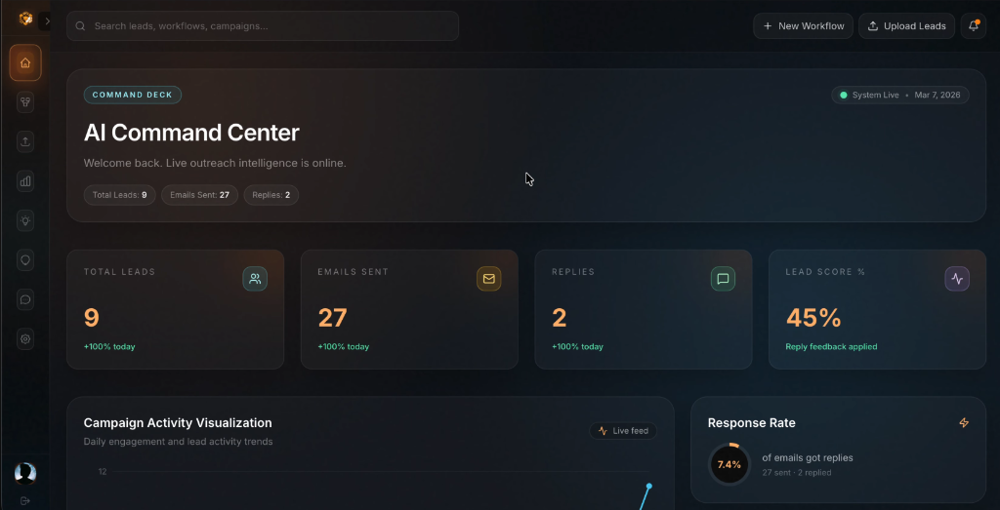
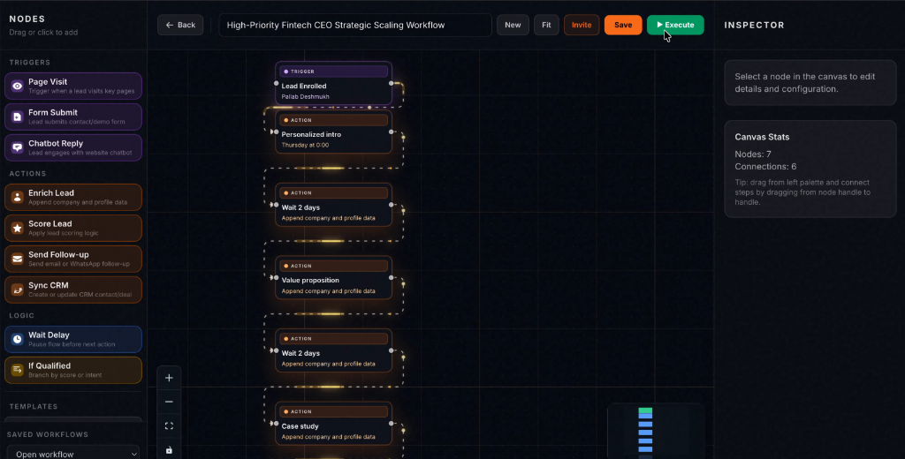
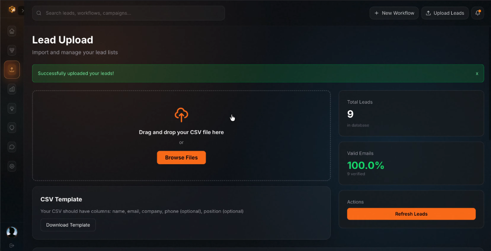
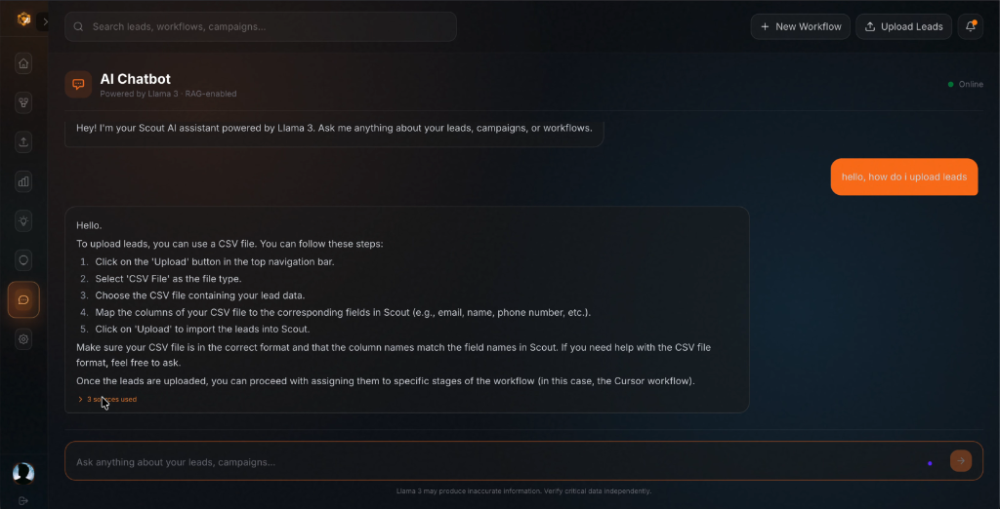

# Scout: Autonomous AI Workflow Automation & Verifiable Outreach Platform

Scout is an enterprise-grade, full-stack workflow automation and outreach intelligence platform. It bridges lead generation, node-based automation design, scalable asynchronous orchestration, machine learning scoring, multi-model LLM generation, omnichannel dispatch, and decentralized execution verification anchored on Filecoin.

---

## Table of Contents

- [Overview](#overview)
- [Platform Interface](#platform-interface)
- [Key Capabilities](#key-capabilities)
- [System Architecture](#system-architecture)
- [Repository Structure](#repository-structure)
- [Technology Stack](#technology-stack)
- [Prerequisites](#prerequisites)
- [Installation and Setup](#installation-and-setup)
- [Environment Configuration](#environment-configuration)
- [Running the Application](#running-the-application)
- [Filecoin Verifiable Execution Layer](#filecoin-verifiable-execution-layer)
- [API Reference](#api-reference)
- [Chrome Extension Integration](#chrome-extension-integration)
- [Conversational Bot & Voice Assistant](#conversational-bot--voice-assistant)
- [Contributing and License](#contributing-and-license)

---

## Overview

Modern sales and growth engineering operations frequently suffer from fragmented tooling: lead scraping occurs in siloed browser tools, workflow configuration is separated from execution queues, AI enrichment lacks runtime adaptation, and execution audit trails are mutable and unverified.

Scout resolves these operational inefficiencies by integrating five foundational layers into a cohesive system:

1. **Lead Capture & Ingestion**: Manifest V3 Chrome extension extracting verified LinkedIn intelligence, paired with bulk CSV/XLSX pipeline ingestion.
2. **Visual Flow Builder**: Infinite-canvas graph builder powered by React Flow with real-time multi-user collaboration via WebSockets.
3. **Distributed Execution Engine**: Fault-tolerant async queue system powered by BullMQ and Redis with branching logic and scheduled delays.
4. **Machine Learning & LLM Layer**: Dedicated Python Flask microservice providing predictive lead scoring, optimal send-time prediction, and context-aware LLM outreach personalization (Groq and Gemini).
5. **Decentralized Verification**: Programmatic audit logging anchored to Filecoin via the Lighthouse SDK, providing immutable Content Identifiers (CIDs) for every workflow run.

---

## Platform Interface

### Landing Page & Growth Platform
Modern dark-mode interface designed for high-velocity growth teams, showcasing autonomous outreach orchestration, AI personalization at scale, and high-converting campaign workflows.


### AI Command Center & Live Analytics
Centralized command deck delivering real-time operational intelligence—monitoring active leads, email dispatch throughput, reply volume, predictive lead scoring feedback, response rates, and live activity feeds.



### Visual Node-Based Workflow Builder
Interactive DAG canvas with drag-and-drop triggers, machine learning scoring filters, LLM generation nodes, scheduled delay logic, CRM sync, and direct one-click workflow execution.



### Lead Management & Bulk Ingestion Pipeline
High-throughput lead ingestion interface featuring drag-and-drop CSV uploads, automated email verification, database synchronization, and template formatting tools.



### Contextual AI Chatbot & Knowledge Assistant
RAG-enabled conversational assistant powered by Llama 3, providing real-time guidance on lead statuses, outreach workflows, campaign execution steps, and cited documentation.



---

## Key Capabilities

### Visual Workflow Automation
- Drag-and-drop node graph builder supporting Triggers, Conditions, Actions, and Delays.
- Multi-branch conditional routing based on lead attributes and engagement responses.
- Real-time multi-user canvas synchronization via Socket.IO.

### Asynchronous Execution Queue
- Production-grade queue management powered by BullMQ and Redis.
- Support for stateful multi-step execution, retries, exponential backoff, and delayed jobs.
- High-throughput batch processing supporting thousands of concurrent leads.

### Predictive AI and Generative Intelligence
- Scikit-learn classification models for automated lead prioritization and quality scoring.
- Regression models for predicting optimal delivery times per lead timezone and behavioral profile.
- Dynamic prompt orchestration via Groq and Gemini for personalized, hyper-targeted email copy.
- Vector database integration (ChromaDB / LangChain) for RAG-assisted contextual chat and inquiries.

### Omnichannel Communication Infrastructure
- High-deliverability SMTP outbound engine with dynamic template compilation.
- Automated IMAP synchronization with background sentiment and reply tracking.
- Interactive Telegram Bot for remote workflow execution, real-time alerting, and command dispatch.
- Twilio Voice integration delivering interactive telephone voice assistant queries for campaign metrics.

### Decentralized Audit Trail (Filecoin)
- Cryptographically verified workflow run execution logs uploaded directly to Filecoin.
- Immutable IPFS Content Identifiers (CIDs) saved to MongoDB records.
- Publicly verifiable audit trail through decentralized storage gateways.

---

## System Architecture

```text
+-----------------------------------------------------------------------------------+
|                                INGESTION LAYER                                    |
|   LinkedIn (Web) -----> Chrome Extension (MV3) -----> REST API Ingestion         |
|   CSV / XLSX Uploads ----------------------------------> Bulk Importer            |
+------------------------------------------+----------------------------------------+
                                           |
                                           v
+-----------------------------------------------------------------------------------+
|                                 CORE BACKEND API                                  |
|   Express.js (REST & WebSockets) | MongoDB (System of Record) | JWT & Google Auth |
+------------------------------------------+----------------------------------------+
                                           |
                                           v
+-----------------------------------------------------------------------------------+
|                             ORCHESTRATION & QUEUES                                |
|   BullMQ Job Scheduler <===============================> Redis Cache & Queue      |
+-------------------+----------------------+-------------------+--------------------+
                    |                      |                   |
                    v                      v                   v
+-----------------------+  +-----------------------+  +-----------------------------+
|     AI/ML SERVICE     |  |   DISPATCH & SYNC     |  |    DECENTRALIZED STORAGE    |
| - Python Flask API    |  | - SMTP (Nodemailer)   |  | - Lighthouse Web3 SDK       |
| - Scikit-Learn Model  |  | - IMAP Reply Tracker  |  | - Filecoin Storage Network  |
| - Groq / Gemini LLMs  |  | - Twilio Voice API    |  | - Immutable CID Generation  |
| - ChromaDB RAG Vector |  | - Telegram Bot Alerts |  | - IPFS Gateway Access       |
+-----------------------+  +-----------------------+  +-----------------------------+
```

---

## Repository Structure

```text
scout/
├── Backend/                    # Node.js Express server & worker processes
│   ├── config/                 # Database, authentication, and environment configs
│   ├── controllers/            # Request handlers (Analytics, Auth, Leads, Workflows)
│   ├── middleware/             # Auth validation, error handlers, request loggers
│   ├── models/                 # Mongoose schemas (User, Lead, Workflow, WorkflowRun, Message)
│   ├── routes/                 # Express API route declarations
│   ├── services/               # BullMQ engine, LLM integration, Filecoin, SMTP/IMAP, Telegram
│   ├── sockets/                # Socket.IO handlers for real-time canvas collaboration
│   ├── workers/                # BullMQ background workers for async workflow execution
│   └── index.js                # Primary backend application entrypoint
├── Frontend/                   # React 19 Single Page Application
│   ├── public/                 # Static public assets, illustrations, and media
│   └── src/
│       ├── assets/             # Logos, vector graphics, and icons
│       ├── components/         # Reusable UI components, navigation, and landing sections
│       ├── pages/              # Primary view pages (Dashboard, WorkflowBuilder, LeadUpload, etc.)
│       └── App.jsx             # React router configuration and global providers
├── ML/                         # Python AI/ML microservice
│   ├── app.py                  # Flask microservice routing
│   ├── emailGen.py             # LLM prompt engineering and message generation
│   ├── leadScoringModel.py     # Scikit-learn lead scoring classifier
│   ├── send_time_model.py      # Send-time optimization regressor
│   └── *.pkl                   # Pre-trained model artifacts and vector encoders
├── Extension/                  # Chrome Extension (Manifest V3)
│   ├── manifest.json           # Chrome extension configuration
│   ├── content.js              # LinkedIn DOM extraction and button injection
│   ├── popup.html / popup.js   # Extension popup interface and lead management
│   └── background.js           # Background service worker and API synchronization
├── docs/                       # Project documentation and interface assets
│   └── images/                 # High-resolution screenshots and architectural diagrams
├── package.json                # Root orchestration scripts
└── README.md                   # Project documentation
```

---

## Technology Stack

| Layer | Technologies |
| :--- | :--- |
| **Frontend** | React 19, Vite, Tailwind CSS v4, React Flow, Framer Motion, Recharts, Lucide Icons, Socket.IO Client, Lenis |
| **Backend API** | Node.js, Express 5, Socket.IO, Passport.js (Google OAuth 2.0), JSON Web Tokens (JWT), Cors, Multer |
| **Orchestration & Queue** | BullMQ, Redis (ioredis), Node Scheduler |
| **Database & Persistence** | MongoDB, Mongoose ODM |
| **AI / Machine Learning** | Python 3, Flask, scikit-learn, Pandas, Joblib, Groq SDK, Google Gemini API, LangChain, ChromaDB |
| **Decentralized Storage** | Filecoin Network, IPFS, Lighthouse Web3 SDK (`@lighthouse-web3/sdk`) |
| **Messaging & Channels** | Nodemailer (SMTP), IMAP (Mailparser), Twilio Voice API, Telegram Bot API |
| **Browser Extension** | Chrome Extensions Manifest V3, Webpack/Vanilla JS, Chrome Storage API |

---

## Prerequisites

Before setting up Scout locally, ensure you have the following dependencies installed:

- **Node.js**: `v20.0.0` or higher
- **npm**: `v10.0.0` or higher
- **Python**: `v3.10` or higher (with `pip`)
- **MongoDB**: `v6.0` or higher (local instance or MongoDB Atlas connection URI)
- **Redis**: `v7.0` or higher (local instance or cloud Redis instance)

---

## Installation and Setup

### 1. Clone the Repository

```bash
git clone https://github.com/pallavdeshmukh/COHERENCE-26_NODEtorious.git
cd scout
```

### 2. Install Root Dependencies

```bash
npm install
```

### 3. Install Backend Dependencies

```bash
cd Backend
npm install
cd ..
```

### 4. Install Frontend Dependencies

```bash
cd Frontend
npm install
cd ..
```

### 5. Install Python ML Microservice Dependencies

```bash
cd ML
pip install flask flask-cors joblib pandas python-dotenv google-genai scikit-learn
cd ..
```

---

## Environment Configuration

### Backend Configuration (`Backend/.env`)

Create a `.env` file in the `Backend/` directory with the following variables:

```env
# Server Configuration
PORT=8000
FRONTEND_URL=http://localhost:5173
JWT_SECRET=your_super_secret_jwt_key

# Database
MONGO_URI=mongodb://localhost:27017/scout

# Redis & Queue Worker
REDIS_HOST=localhost
REDIS_PORT=6379

# Decentralized Storage (Filecoin via Lighthouse)
LIGHTHOUSE_API_KEY=your_lighthouse_api_key

# AI / ML Microservice Integration
ML_API_URL=http://127.0.0.1:5001/api/ml
GROQ_API_KEY=your_groq_api_key
LLM_API_KEY=your_gemini_api_key

# Email Dispatch & Inbound Reply Tracking (SMTP / IMAP)
SMTP_USER=your_email@gmail.com
SMTP_PASS=your_app_specific_password
IMAP_HOST=imap.gmail.com
IMAP_PORT=993

# Google OAuth 2.0
GOOGLE_CLIENT_ID=your_google_client_id.apps.googleusercontent.com
GOOGLE_CLIENT_SECRET=your_google_client_secret
GOOGLE_CALLBACK_URL=http://localhost:8000/auth/google/callback

# Optional Integrations
TELEGRAM_BOT_TOKEN=your_telegram_bot_token
TWILIO_ACCOUNT_SID=your_twilio_account_sid
TWILIO_AUTH_TOKEN=your_twilio_auth_token
TWILIO_PHONE_NUMBER=+1234567890
```

### Frontend Configuration (`Frontend/.env`)

Create a `.env` file in the `Frontend/` directory:

```env
VITE_API_URL=http://localhost:8000
```

---

## Running the Application

### Option A: Concurrent Start (Recommended)

Start all services (Frontend, Backend, ML microservice, Redis, and tunneling) from the root directory with a single command:

```bash
npm run dev
```

### Option B: Individual Microservice Start

Open separate terminal sessions for each component:

#### 1. Start Redis Server
```bash
redis-server
```

#### 2. Start Python ML Microservice
```bash
cd ML
python app.py
```
*Service initializes on `http://127.0.0.1:5001`*

#### 3. Start Backend Express Engine & Workers
```bash
cd Backend
npm run dev
```
*Server initializes on `http://localhost:8000`*

#### 4. Start Frontend Client
```bash
cd Frontend
npm run dev
```
*Vite application will be accessible at `http://localhost:5173`*

---

## Filecoin Verifiable Execution Layer

Scout introduces verifiable proof of execution for workflow automation. Traditional automation platforms operate as closed black boxes; Scout anchors immutable completion logs onto the Filecoin decentralized storage network using the Lighthouse SDK.

```text
[ Workflow Execution Completed ]
               │
               ▼
[ Serialize Run Log: ID, Status, Step Trace, Timestamp ]
               │
               ▼
[ Upload Buffer to Filecoin via Lighthouse SDK ]
               │
               ▼
[ Retrieve Immutable IPFS CID (e.g. QmZ...2f1) ]
               │
               ▼
[ Persist CID into MongoDB WorkflowRun.filecoinCID ]
               │
               ▼
[ Public Verification via Gateway: https://gateway.lighthouse.storage/ipfs/<CID> ]
```

### Verification Log Schema

Each decentralized log record contains:

```json
{
  "workflowRunId": "65e8b3f12a9c1d0012a4b890",
  "workflowId": "65e8b2a02a9c1d0012a4b884",
  "leadId": "65e8b15d2a9c1d0012a4b872",
  "status": "COMPLETED",
  "executedSteps": [
    { "nodeId": "node-1", "type": "trigger", "status": "SUCCESS" },
    { "nodeId": "node-2", "type": "ai_score", "score": 88, "status": "SUCCESS" },
    { "nodeId": "node-3", "type": "llm_generate", "model": "groq-llama3", "status": "SUCCESS" },
    { "nodeId": "node-4", "type": "smtp_send", "messageId": "<msg-001@scout>", "status": "SUCCESS" }
  ],
  "timestamp": "2026-03-27T08:30:00.000Z",
  "source": "Scout Workflow Engine",
  "verifier": "Lighthouse-Filecoin-Gateway"
}
```

---

## API Reference

### Authentication Endpoints
- `POST /api/auth/register` — Register a new account
- `POST /api/auth/login` — Authenticate and issue JWT
- `GET /auth/google` — Initiate Google OAuth 2.0 flow
- `GET /auth/google/callback` — Google OAuth redirect callback

### Lead Management Endpoints
- `GET /api/leads` — Retrieve lead list with pagination and search
- `POST /api/leads` — Create or manually insert a lead
- `POST /api/leads/upload` — Bulk import leads via CSV or XLSX file
- `POST /api/enroll-lead` — Single-lead enrollment endpoint (Extension target)
- `POST /api/sync-leads` — Batch lead synchronization endpoint

### Workflow Design & Execution
- `GET /api/workflows` — Fetch all configured workflow graphs
- `POST /api/workflows` — Create a new workflow canvas definition
- `PUT /api/workflows/:id` — Update workflow nodes, edges, and configuration
- `DELETE /api/workflows/:id` — Delete a workflow
- `POST /api/workflows/:id/run` — Trigger workflow execution across selected leads
- `GET /api/workflow-runs` — Retrieve workflow execution history and run statuses
- `GET /api/workflow-runs/:id` — Retrieve run details, step status, and Filecoin CID

### Analytics & Intelligence
- `GET /api/analytics/metrics` — Dashboard performance metrics and KPIs
- `POST /api/ml/score-lead` — Execute ML lead scoring model
- `POST /api/ml/best-send-time` — Predict optimal outreach timestamp
- `POST /api/ml/generate-email` — Generate personalized email draft via LLM
- `POST /api/chatbot` — Query RAG knowledge assistant

### Filecoin Storage
- `GET /api/filecoin/verify/:cid` — Inspect and verify decentralized log CID

---

## Chrome Extension Integration

The **Intelligence Scout** extension enables direct lead capture from LinkedIn profiles.

### Installation Instructions
1. Open Google Chrome and navigate to `chrome://extensions/`.
2. Toggle **Developer mode** in the top-right corner.
3. Click **Load unpacked**.
4. Select the `Extension/` directory from this repository.
5. In `Extension/config.js` or `Extension/popup.js`, verify the backend endpoint:
   ```javascript
   const API_BASE_URL = 'http://localhost:8000';
   ```

### Extension Features
- Injects a native **Send to Scout** action button on LinkedIn profile headers.
- Captures Lead Name, Job Title, Company, Location, and Profile URL.
- Evaluates profile data against the AI classification service to suggest engagement angles (Technical, Business, or Executive).
- Displays a real-time **Send Timing Meter** to prevent spam flagging by enforcing human-like pacing.
- Supports local lead queuing with one-click bulk synchronization to the Scout web dashboard.

---

## Conversational Bot & Voice Assistant

### Telegram Bot
Scout includes an integrated Telegram Bot (`Backend/services/telegramBot.js`) allowing growth managers to monitor and command operations remotely:
- Receive real-time notifications on campaign replies and workflow milestones.
- Query active lead volumes, open rates, and conversion numbers via chat commands.
- Trigger and pause specific workflow automations directly from Telegram.

### Twilio Voice Assistant
The voice gateway (`/api/voice`) enables real-time phone interactions:
- Incoming voice webhooks trigger an interactive speech-recognition IVR.
- Users can call their designated Twilio number to query metrics (e.g., *"How many replies did we receive today?"* or *"What is our current meeting conversion rate?"*).
- Responses are computed dynamically from MongoDB analytics and returned via synthesized speech (TwiML).

---

## Contributing and License

### Development Workflow
1. Fork the repository.
2. Create a feature branch (`git checkout -b feature/workflow-enhancement`).
3. Commit your changes (`git commit -m "Add conditional webhook node"`).
4. Push to the branch (`git push origin feature/workflow-enhancement`).
5. Open a Pull Request.

### License
This project is licensed under the [MIT License](LICENSE).
